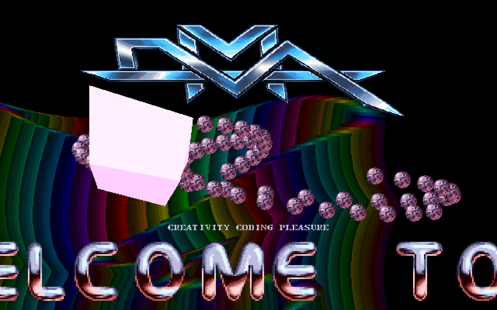
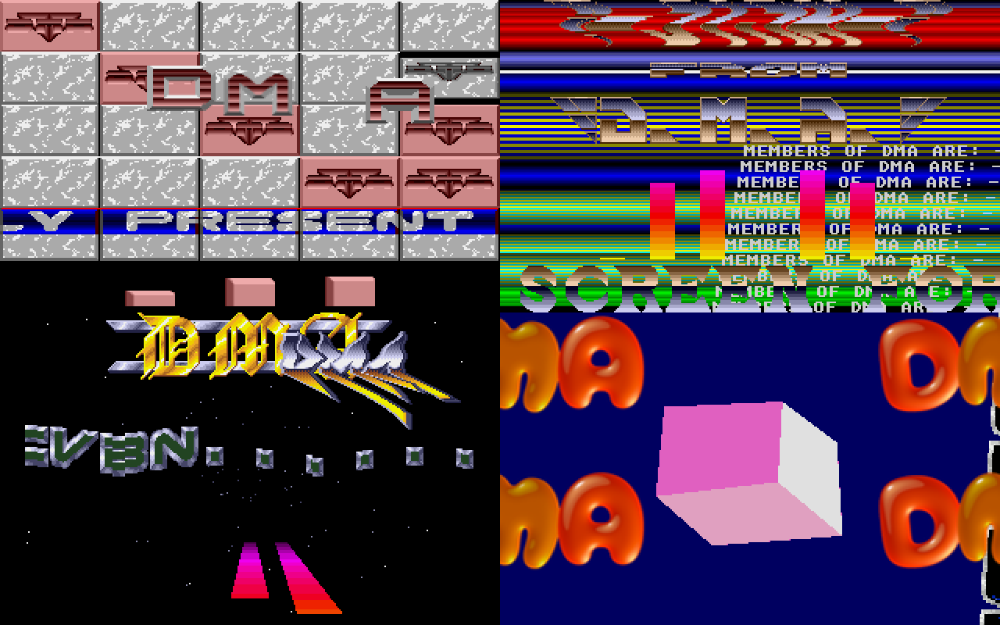
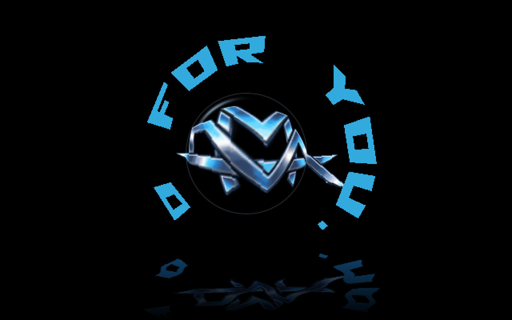
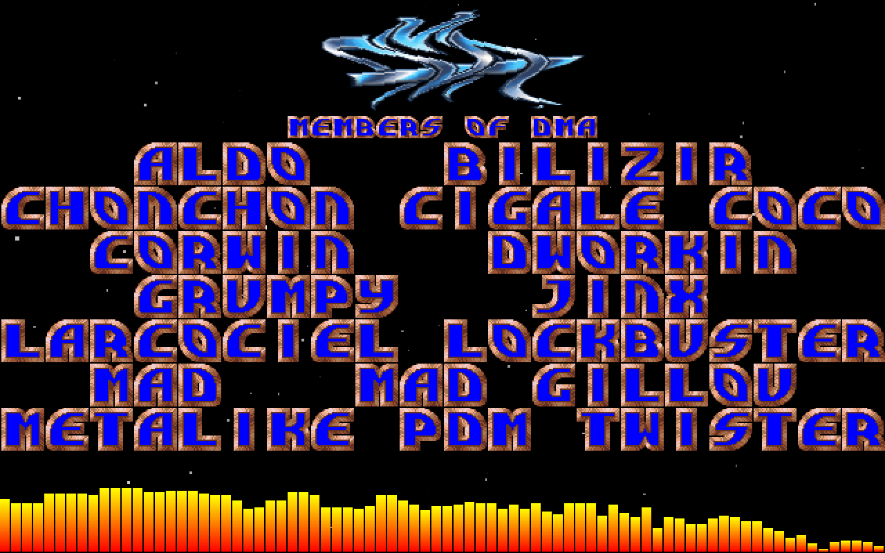
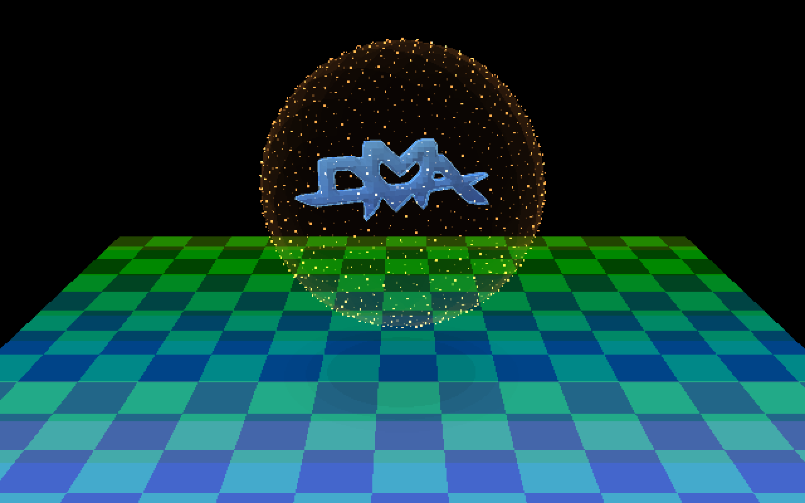
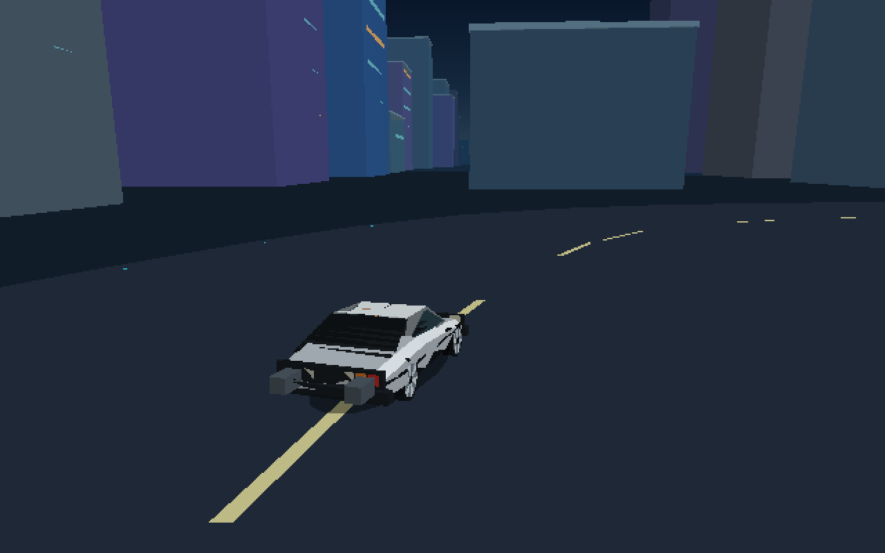
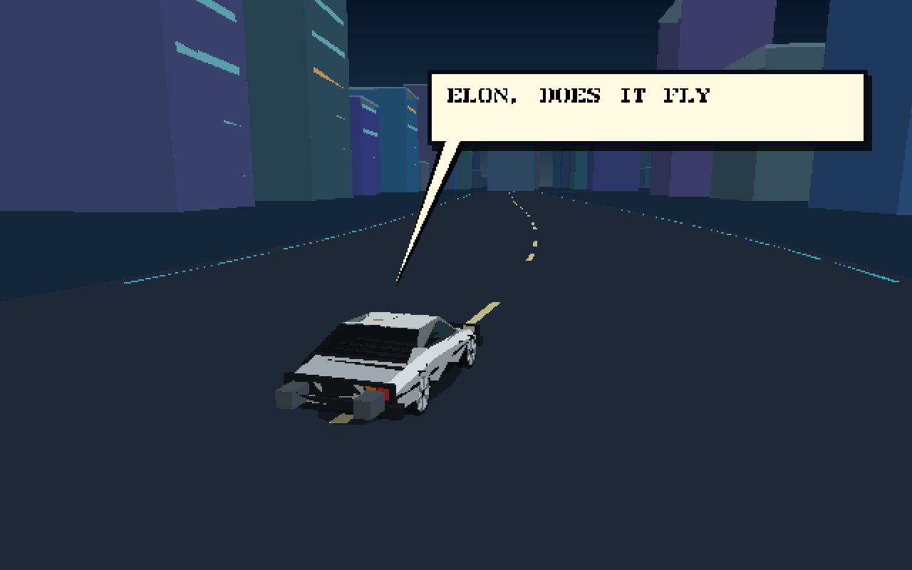
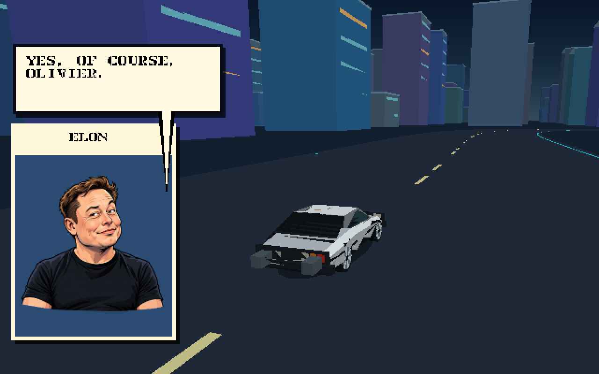
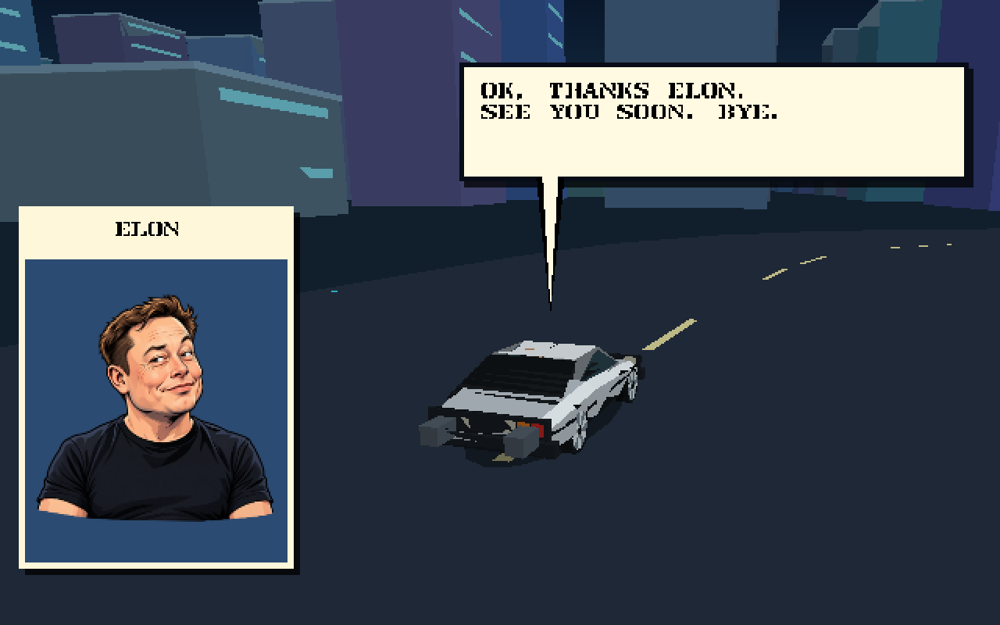

# DMA40

DMA40 is a megademo created for DMA's fortieth anniversary. DMA was
founded in **1987**, and this new production carries its Atari ST demoscene
spirit into a native Go/Ebitengine program for desktop and Android.



## DMA since 1987

DMA40 celebrates the people who shaped DMA across its history:

| | | | |
| --- | --- | --- | --- |
| Aldo | Bilizir | Chonchon | Cigale |
| Coco | Corwin | Dworkin | Grumpy |
| Jinx | Larcociel | Lockbuster | Mad |
| Mad Gillou | Metalike | PDM | Twister |

> **French fries are good for you :)**

## The production

The presentation starts by revisiting four DMA screens, then grows into a new
sequence of vectorballs, a metal spoon, volumetric flight, Matrix rain, Pac-Men,
a circular scroll with water and a magnifying lens, a DeLorean city interlude,
the Noname members page, a glass DMA logo, a flocking portrait and a deciphered
page of pi digits. The soundtrack moves continuously through YM and MOD pieces,
and the whole production closes by itself.

[Demo Construction Kit (DCK)](https://github.com/olivierh59500/democonstructionkit)
is central to DMA40. DCK supplies deterministic clocks, effect composition,
scrolling, sprites, audio playback, fixed-frame recording and reusable 2D and 3D
effects, while DMA40 keeps its production-specific scene controllers in Go.

| Four DMA screens | Circular scroll and lens |
| --- | --- |
|  |  |

| DMA members | Jelly DMA |
| --- | --- |
|  |  |

## The Elon sequence

| The city drive | The question |
| --- | --- |
|  |  |

| Elon's answer | See you soon |
| --- | --- |
|  |  |

## Desktop

DMA40 requires Go 1.26 or newer. All prepared runtime artwork, music and
resource bundles are included and embedded in the executable, so a fresh clone
can run immediately without a separate asset-generation step.

Run the complete production:

```sh
GOCACHE="$PWD/.cache/go-build" go run ./cmd/dma40
```

| Input | Action |
| --- | --- |
| Space | Advance the current authored scene |
| P | Pause or resume |
| S | Toggle sound |
| F11 | Toggle fullscreen |
| Escape | Exit |

The logical canvas is 640×400. Playback starts automatically and follows the
same sequence on desktop and Android.

## Video and screenshots

```sh
GOCACHE="$PWD/.cache/go-build" go run ./cmd/video
```

The exporter uses DCK's fixed clock and PCM mixer to render the complete
production at 50 frames per second. It writes a chaptered WebM presentation and
lossless screenshots outside Git.

## Android

Build the Android APK with the local SDK, NDK and JDK 17:

```sh
GOCACHE="$PWD/.cache/go-build" go run ./cmd/android
```

The output is `dist/dma40-android.apk`. A double tap advances one scene; ordinary
touches do not interrupt the presentation.

## Credits

DMA40 is a DMA production conceived and coded by Bilizir in Go with Ebitengine
and DCK. It incorporates authorized material from earlier DMA productions and
credited source productions. Original artwork, music, names and source material
remain the property of their respective authors.
